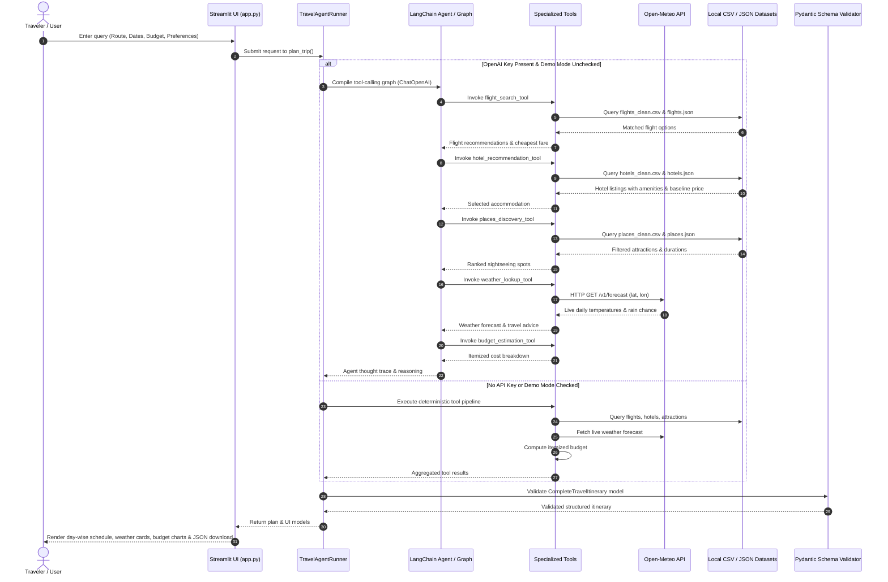

# Project Workflow: Agentic AI Travel Planning Assistant

This document details the end-to-end operational lifecycle, execution sequence, and decision-making logic of the travel planning system.

---

## 1. End-to-End Workflow Diagram

---

## 2. Step-by-Step Lifecycle

### Step 1: User Request & Intent Extraction
1. The user provides a natural language query (e.g. *"Plan a 3-day relaxing trip to Goa for 2 from Delhi with ₹40,000 budget"*).
2. The Streamlit interface extracts origin, destination, trip dates, traveler count, and travel style preferences.

### Step 2: Agent Orchestration & Tool Execution
1. **Flight Search:**
   - Searches historical fares between origin and destination.
   - Evaluates airlines, schedules, and duration.
   - Identifies the cheapest and fastest domestic flights.
2. **Hotel Recommendation:**
   - Discovers properties matching location and preferred amenities (e.g. pool, wifi).
   - Validates ratings and selects central, high-reputation accommodation.
3. **Tourist Attraction Discovery:**
   - Retrieves attractions categorized by style (Beaches, Forts, Temples, Palaces).
   - Checks visit durations and closing days (weekly off) to prevent scheduling impossible stops.
4. **Live Weather Query:**
   - Translates destination city into GPS coordinates.
   - Queries Open-Meteo API for real-time 5-day temperature highs, lows, and rain probabilities.
5. **Budget Calculation:**
   - Applies the academic formula:
     $$\text{Total Budget} = \text{Flights} + \text{Hotels} + \text{Food} + \text{Local Transport} + \text{Entrance Fees} + \text{Contingency Buffer}$$
   - Itemizes costs by traveler and by category.

### Step 3: Synthesis & Pacing Optimization
- **Day 1 (Arrival):** Accounts for flight landing and check-in logistics; schedules light afternoon and sunset activities.
- **Middle Days (Exploration):** Distributes 2 to 3 major attractions per day (morning, afternoon, evening) with realistic transit breaks.
- **Final Day (Departure):** Accommodates hotel check-out, souvenir shopping, and airport transit.

### Step 4: Schema Validation & Delivery
- Validates the complete structure against the `CompleteTravelItinerary` Pydantic model.
- Persists output to `outputs/itinerary_<city>_<timestamp>.json`.
- Displays responsive tabs in Streamlit and enables instant JSON download.

---

## 3. Error Handling and Resilience

| Potential Failure | System Mitigation Strategy |
| :--- | :--- |
| **No OpenAI API Key** | Seamlessly operates in full Deterministic Demo Mode with 100% features enabled. |
| **Open-Meteo Timeout / Offline** | Catches `requests.exceptions.Timeout` within 6 seconds; returns seasonal climate guidance. |
| **Identical Origin & Destination** | UI input validation blocks generation with an informative error message. |
| **Unknown City Coordinates** | City alias lookup normalizes common names; falls back to regional coordinates. |
| **Missing Hotel Prices in Crawl** | Uses baseline reference rates from `hotels.json` and clearly tags them as estimates. |
